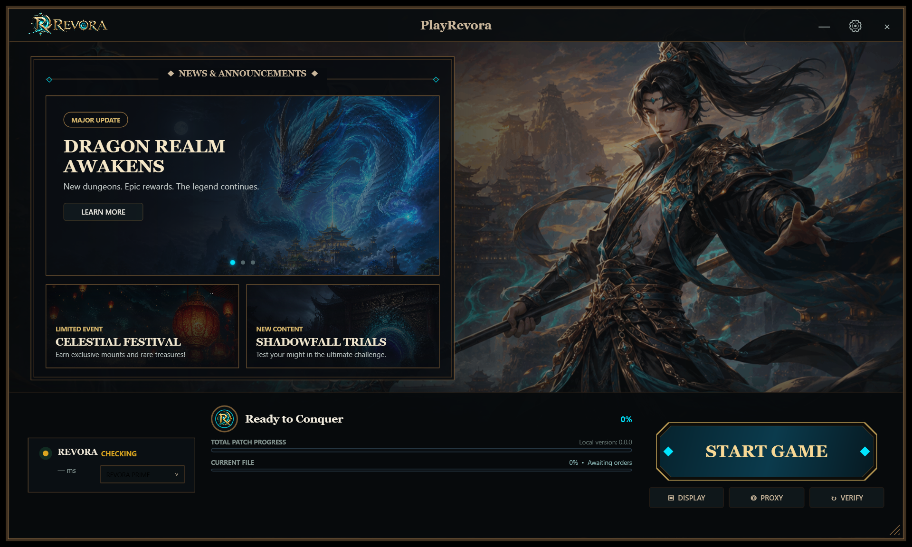

# PlayRevora launcher interface

## Shell and composition

- 1280 × 768 logical, transparent frameless WPF shell with a 1200-pixel
  minimum width, bronze outer frame, inner highlight, drag header, and custom
  bottom-right resize hit target.
- Centered `PlayRevora` title, official wordmark at left, and minimal window
  controls at right.
- Full-bleed official guardian/city artwork with directional and footer
  vignettes plus pointer-driven parallax.
- Official Revora crest occupies the upper action-side anchor.

## News console

- Dual-line engraved left frame with cyan diamond corner details.
- Rotating featured carousel starts with `DRAGON REALM AWAKENS` and includes a
  tag, subtitle, Learn More action, generated celestial-dragon artwork, and
  pagination dots.
- Two subordinate cards present `CELESTIAL FESTIVAL` and `SHADOWFALL TRIALS`
  over dedicated generated artwork.

## Footer console

- Realm panel binds online state, live HTTP latency, and selected gateway.
- Center telemetry binds actual updater/doctor status, total progress, current
  file progress, version, and measured transfer or hashing label.
- Octagonal Start Game button binds `LaunchGameCommand`, which applies and
  validates display settings before the safe executable launch path.
- Display opens the settings console, Proxy toggles and persists the reviewed
  D3D9 proxy, and Verify invokes the real Client Doctor service.

## Generated promotional assets

The built-in image generation tool produced three text-free fantasy card
backgrounds in the official obsidian/cyan/antique-gold palette:

- `Assets/news-dragon-realm.png`: celestial blue eastern dragon over a mountain
  temple realm, with dark copy space.
- `Assets/news-celestial-festival.png`: floating lantern festival over an
  ancient fantasy city.
- `Assets/news-shadowfall-trials.png`: ruined temple gate containing a
  cyan-violet portal.

All official logos, background artwork, and the application icon remain sourced
from `C:\Revora\Web\wwwroot`.
